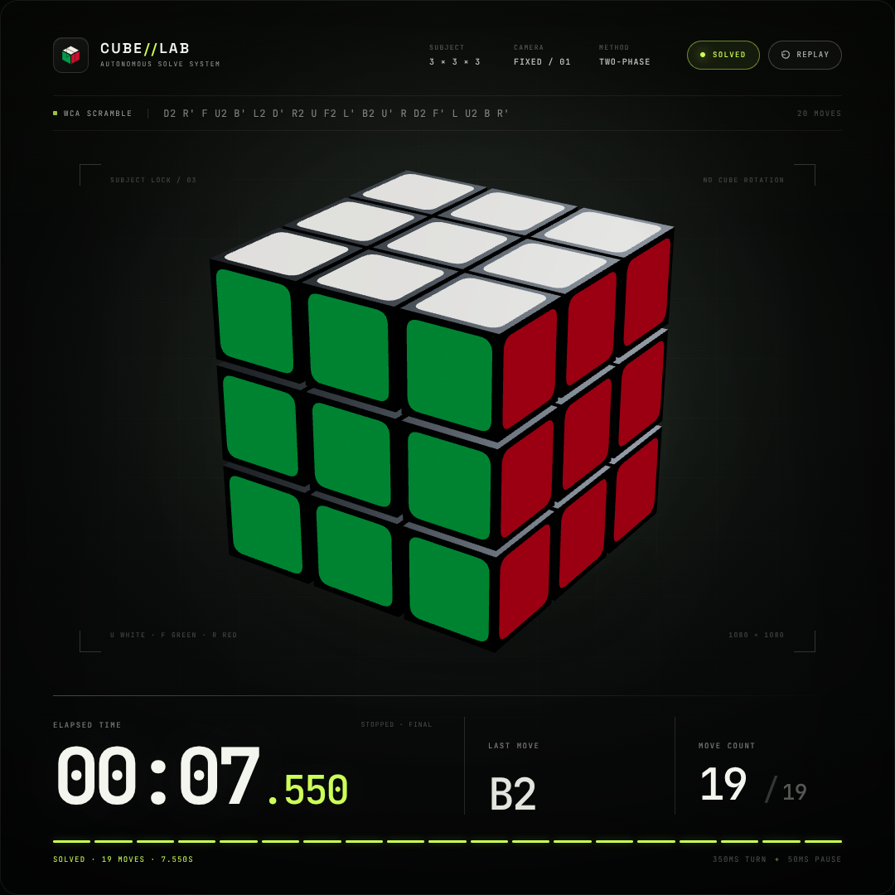

# cube-lab

[](LICENSE)

**Cube//Lab — autonomous 3×3 solve.** A self-contained 1080×1080 WebGL demo:
a 3×3×3 cube is scrambled with a fixed WCA scramble, then solved by a
deterministic 19-move sequence — with a live stopwatch, current-move readout
and per-move progress HUD.

**Live: <https://vbao.github.io/cube-lab/>**



## How it works

- **One file, zero network.** `index.html` (~835 KB) inlines three.js r160
  (MIT), both typefaces as WOFF2 data URIs, and all styling and scripting. It
  runs offline by opening the file; nothing is fetched at runtime.
- **Exactly timed.** The solve runs on one wall-clock timeline: 350 ms per
  animated turn plus a 50 ms pause, so the stopwatch stops at exactly
  `00:07.550` for the 19 moves. If the browser misses frames across a move
  boundary, whole moves are fast-forwarded instead of letting the timeline
  drift.
- **The final state is proven, not assumed.** When the animation ends, the
  page reads back all 54 facelets from the live 3D scene and asserts they
  equal the solved cube (`window.__cubeLab.isSolved()`, also logged).
- **Fixed camera, no whole-cube rotation.** Layer turns only; U white, F
  green, R red standard colour scheme.
- The artboard scales to fit smaller viewports while keeping its exact
  1080×1080 composition.

The scramble and solution are baked in, but they are real: the solution is not
the inverse of the scramble, and the scramble → solved progression was
verified against independent cube models (including Kociemba) as part of QA.

## Run it

Open `index.html` in a modern browser, or serve the folder:

```bash
python3 -m http.server 8080
```

Press **REPLAY** (or `R`) after a solve to watch it again.

## Credits

- [three.js](https://threejs.org) r160 — MIT
- Space Grotesk and JetBrains Mono — SIL Open Font License 1.1

## License

MIT — see [LICENSE](LICENSE).
